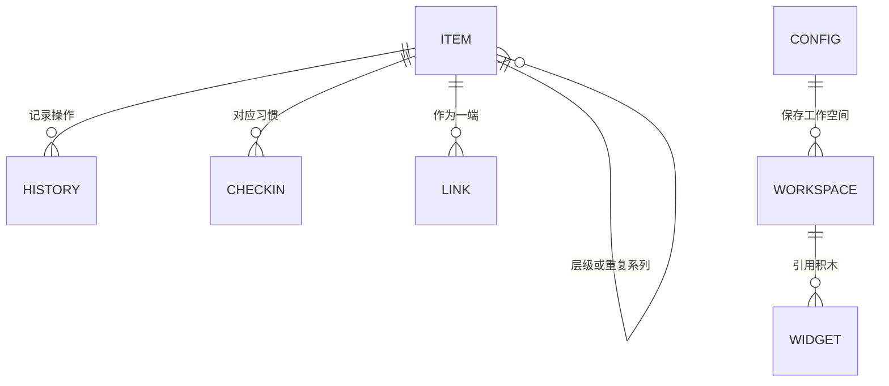

# 技术设计与验收

项目以共享会话《拾刻 v1.0 产品需求与技术设计总纲》为依据。Compose、Room、Keystore 和通知均由 Android 原生 API 提供。最低 API 31，编译和目标 API 35。Gradle 8.11.1、AGP 8.9.1、Kotlin 2.1.20、Room 2.7.1、SQLCipher 4.10.0 和 WorkManager 2.10.1 均在构建脚本固定。

## 数据结构

Room 是业务数据的事实来源。对象通过 UUID 标识。逻辑关系包括任务与笔记的双向查询、计划与任务及习惯关联、自引用层级、文件夹、分类、标签和重复实例。工作空间只保存积木配置，多个工作空间展示同一份业务数据。ViewModel 消费 Repository 提供的 Flow。新库没有历史迁移版本，已导出 Room 初始 schema，后续变更需要配套迁移。

## 加密与迁移

Room 通过 SQLCipher SupportOpenHelperFactory 打开数据库。数据库使用随机密钥，密钥由 Android Keystore 生成的 AES 密钥包装并保存在不参与备份的目录。数据库开库失败时不会创建明文备用库，也不会自动重置现有库。数字应用锁与数据库密钥分离，可启用系统生物识别。

备份使用 PBKDF2-HMAC-SHA256 派生独立密钥并用 AES-GCM 封装。恢复先认证和验证内容，再通过一个数据库事务替换。错误密码与文件篡改在替换之前报错。应用锁凭据随恢复重设。Android 系统备份仅允许搬运用户主动开启的独立加密备份文件，并在迁移后通过备份密码手动恢复。

## 当前试用范围

| 模块 | 可试用行为 |
| --- | --- |
| 任务 | 六种状态、重开、历史、优先级、开始和截止时间、子任务、关联、提醒、过滤、回收站 |
| 重复任务 | 日历周期、指定星期、月末日期收敛、独立实例、暂停、跳过、将规则用于未来未改动的实例 |
| 习惯 | 完成型、时长型、数量型、自定义型，按周期打卡，保留每次的目标和记录，显示连续完成周期 |
| 笔记和计划 | Markdown 文本、笔记版本、文件夹、标签、分类、子计划、手动与自动进度 |
| 日历和回顾 | 月／周／日、对象筛选、全天与跨日、基础统计和历史回顾 |
| 布局 | 多工作空间、积木网格、长按移动、两档宽度、分组嵌套、复制、锁定、折叠、快照、最近 50 步撤销 |
| 搜索 | 本地标题和正文、拼音、首字母、近似匹配、同义词、历史记录、类型过滤 |
| 保护 | 数据库加密、恢复与密码校验、应用锁、加密导出、回收站默认 30 天、笔记版本默认 20 个 |

## 正式验收前的缺口

- 早期资料明确了六种任务状态和允许重开，目前试用版允许手动切换任意不同状态。更细的状态转换规则还需要核对。
- 搜索目前扫描本地缓存，尚需持久化全文索引、完善中文切词和大数据量测试。
- 积木先提供宽窄两档，拖动按相邻网格位置移动。更精细的拖动预览、尺寸和字段配置、独立交互设置及完整日历内嵌仍待实现。
- 重复实例自 0.2 起只按今日、下一次及打开的日历范围生成；普通任务列表对系列进行投影，完整历史仍保留。跨时区和后台生成仍需设备实测。
- 独立中英数字字体、部分动画和性能参数、周总结提醒、增强统计筛选及习惯应打卡分母尚未完整覆盖。
- 需要在实际 Android 12+ 手机上核验启动、后台提醒、权限降级、TalkBack、系统备份传输、签名升级和性能。系统备份与跨设备验证不能用单机模拟器结果替代。
